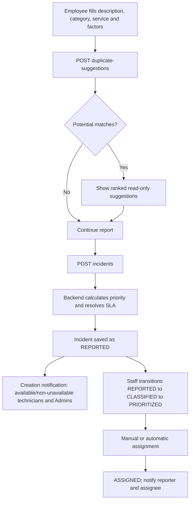
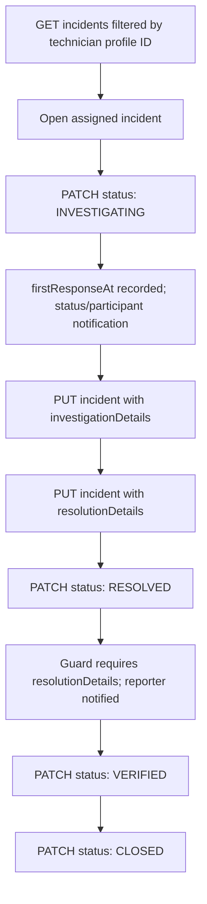
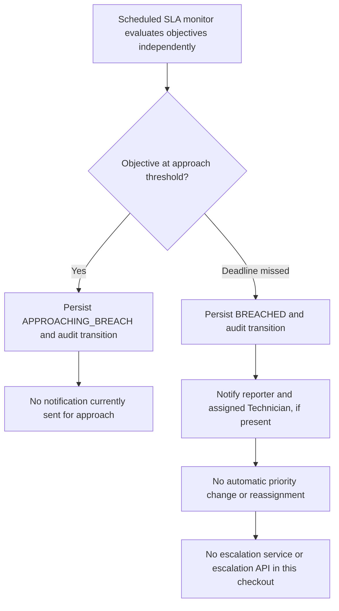
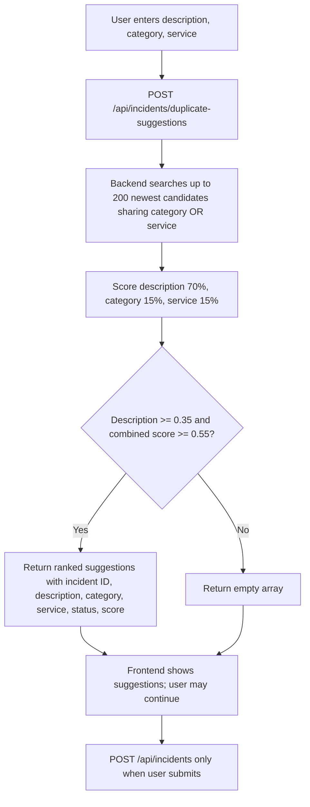

# Radar Frontend Integration Handoff

This guide describes the backend that exists in this checkout. It is based on the Java controllers, DTOs, services, entities, enums, lifecycle states, security rules and repositories. Do not treat planned behavior or this document's UI suggestions as additional API capabilities.

## 1. Backend connection and authentication

Local backend base URL is `http://localhost:8080` (`server.port=8080` in `application.properties`). All application endpoints are under `/api`.

Configured CORS origins include `http://localhost:3000` and `http://localhost:5173`; JSON and Authorization headers and GET/POST/PUT/PATCH/DELETE/OPTIONS methods are allowed for these origins.

### Register and login

| Operation | Method and URL | Access |
|---|---|---|
| Register | `POST /api/auth/register` | Public; creates an Employee account only |
| Login | `POST /api/auth/login` | Public |
| Current user | `GET /api/auth/me` | JWT required |

Registration body (`RegisterRequest`):

```json
{"name":"Alex Morgan","email":"alex.morgan@example.com","password":"Example-password-42"}
```

Name is required and max 100 characters; email must be valid and max 150; password is required and 8–100 characters. Registration normalizes email to lowercase and returns 409 if already registered.

Login body (`LoginRequest`):

```json
{"email":"alex.morgan@example.com","password":"Example-password-42"}
```

Both endpoints return `AuthResponse` (register 201, login 200):

```json
{
  "token":"<JWT>",
  "user":{"id":42,"name":"Alex Morgan","email":"alex.morgan@example.com","role":"USER","createdAt":"2026-11-19T10:15:30Z"}
}
```

Use the top-level `token` for subsequent requests:

```http
Authorization: Bearer <JWT>
```

Tokens expire after the configured `app.jwt.expiration-ms` (default 24 hours). `GET /api/auth/me` returns the logged-in `UserResponse` without a token field. All API routes except login/register require authentication; `OPTIONS /**` is also permitted for CORS preflight and is not a business endpoint.

### Roles and visibility

The internal roles are `EMPLOYEE`, `TECHNICIAN`, and `ADMIN`. JSON writes accept `USER` as an alias for `EMPLOYEE`; JSON responses emit `USER` for Employees. The explicit `@PreAuthorize` restrictions are summarized in the endpoint table below. Routes without a method-level role annotation still require a JWT.

Employees can list and view only incidents they reported. Technicians and Admins can see all incidents. Employee updates are limited to permitted non-classification fields (in practice the description); classification, SLA, priority and staff detail fields require Technician/Admin. Comments and audit access use incident visibility. Notification routes only expose the current user's notifications.

Common errors use this response structure:

```json
{"timestamp":"2026-11-19T10:20:00Z","status":400,"error":"Bad Request","message":"Validation failed","fieldErrors":{"description":"Description is required"}}
```

Central mappings: 400 validation/malformed request or business bad request; 401 missing/invalid JWT or bad credentials; 403 role/access denied; 404 missing resource; 409 conflict/lifecycle or assignment rule. Unexpected persistence/infrastructure failures are not all normalized.

## 2. Incident management

### Create

`POST /api/incidents` takes `IncidentCreateRequest` and returns 201 with the full `IncidentResponse` shape below. All roles may create an incident.

```json
{
  "description":"Email service is unavailable for my team",
  "categoryId":1,
  "serviceId":1,
  "slaPolicyId":null,
  "impact":"MEDIUM",
  "urgency":"MEDIUM",
  "businessCriticality":"MEDIUM",
  "priority":null
}
```

`description` is nonblank and max 10,000 characters. Category, service, impact, urgency and business criticality are required; IDs must be positive. `slaPolicyId` and `priority` are optional. Priority is calculated by the currently active strategy; a supplied `priority` is only accepted when it matches that result. SLA policy must match the calculated priority. If omitted, a policy for that priority must exist or the request conflicts (409). Response and resolution deadlines are based on the incident creation time plus policy durations.

Important lifecycle detail: **creation leaves status as `REPORTED`**. It calculates/persists priority and SLA deadlines, but does not move through `CLASSIFIED`/`PRIORITIZED` or assign a technician.

### Duplicate suggestions

Before submission, `POST /api/incidents/duplicate-suggestions` accepts:

```json
{"description":"Email service is unavailable for my team","categoryId":1,"serviceId":1}
```

Response is an array, for example:

```json
[{"incidentId":88,"description":"Team cannot access email service","category":"Network","service":"Email","status":"INVESTIGATING","similarityScore":0.71}]
```

No matches returns `[]`. Candidate incidents share category or service; description Dice token similarity (70%), category (15%) and service (15%) contribute to score. Text must score at least 0.35 and combined score at least 0.55, so category/service coincidence alone is insufficient. Up to 200 newest candidates are scored. Suggestions are read-only, not merges. Employees only see their own existing reports; staff can see all candidates. Invalid fields return 400; unknown category/service returns 404.

### Incident response shape

`IncidentResponse` is returned by create, get, update, manual assignment, status change, and as a nested object in auto-assignment/recalculation responses.

```json
{
  "id":101,
  "reporter":{"id":42,"name":"Alex Morgan","email":"alex.morgan@example.com","role":"USER","createdAt":"2026-11-19T10:15:30Z"},
  "assignedTechnician":null,
  "category":{"id":1,"name":"Network","description":"Network issues"},
  "service":{"id":1,"name":"Email","description":"Email service"},
  "slaPolicy":{"id":3,"name":"P3 Standard","priority":"P3","responseTimeMinutes":60,"resolutionTimeMinutes":480},
  "description":"Email service is unavailable for my team",
  "impact":"MEDIUM","urgency":"MEDIUM","businessCriticality":"MEDIUM",
  "priority":"P3","status":"REPORTED","slaStatus":"NOT_STARTED",
  "responseSlaStatus":"NOT_STARTED","resolutionSlaStatus":"NOT_STARTED",
  "investigationDetails":null,"resolutionDetails":null,"closureDetails":null,
  "createdAt":"2026-11-19T10:15:30Z","firstResponseAt":null,"resolvedAt":null,"closedAt":null,
  "responseDeadline":"2026-11-19T11:15:30Z","resolutionDeadline":"2026-11-19T18:15:30Z"
}
```

Nested `reporter` is `UserResponse`; `assignedTechnician` is null or `TechnicianResponse`; category/service/SLA policy use their corresponding response DTOs. Times are ISO-8601 instants (UTC `Z` in examples).

### List, search and filters

`GET /api/incidents` returns a `PageResponse<IncidentResponse>`. A representative response:

```json
{"content":[{"id":101,"reporter":{"id":42,"name":"Alex Morgan","email":"alex.morgan@example.com","role":"USER","createdAt":"2026-11-19T10:15:30Z"},"assignedTechnician":null,"category":{"id":1,"name":"Network","description":"Network issues"},"service":{"id":1,"name":"Email","description":"Email service"},"slaPolicy":{"id":3,"name":"P3 Standard","priority":"P3","responseTimeMinutes":60,"resolutionTimeMinutes":480},"description":"Email service is unavailable for my team","impact":"MEDIUM","urgency":"MEDIUM","businessCriticality":"MEDIUM","priority":"P3","status":"REPORTED","slaStatus":"NOT_STARTED","responseSlaStatus":"NOT_STARTED","resolutionSlaStatus":"NOT_STARTED","investigationDetails":null,"resolutionDetails":null,"closureDetails":null,"createdAt":"2026-11-19T10:15:30Z","firstResponseAt":null,"resolvedAt":null,"closedAt":null,"responseDeadline":"2026-11-19T11:15:30Z","resolutionDeadline":"2026-11-19T18:15:30Z"}],"page":0,"size":20,"totalElements":1,"totalPages":1}
```

Query parameters:

| Parameter | Meaning / accepted values |
|---|---|
| `priority` | `P1`, `P2`, `P3`, `P4` |
| `status` | `REPORTED`, `CLASSIFIED`, `PRIORITIZED`, `ASSIGNED`, `INVESTIGATING`, `RESOLVED`, `VERIFIED`, `CLOSED` |
| `technicianId` or `assigneeId` | Technician profile ID (not user ID); `technicianId` takes precedence if both are supplied |
| `search` | Case-insensitive description substring |
| `page` | Zero-based, default 0; negative gives 400 |
| `size` | Default 20, clamped to 1–100 |
| `sortBy` | `createdAt` (default), `priority`, `status`, `description`, or `id` |
| `direction` | `asc` or `desc` (default `desc`) |

`GET /api/incidents/{id}` returns one full incident response. Employee access to someone else's incident is 403. Missing ID is 404.

### Update

`PUT /api/incidents/{id}` is a partial-field update (omitted/null fields are left as-is). Fields in `IncidentUpdateRequest`:

```json
{
  "description":"Email outage affects the finance team",
  "categoryId":1,
  "serviceId":1,
  "slaPolicyId":null,
  "impact":"HIGH",
  "urgency":"MEDIUM",
  "businessCriticality":"MEDIUM",
  "priority":null,
  "investigationDetails":"Mail relay is being checked",
  "resolutionDetails":null,
  "closureDetails":null
}
```

All fields are optional; description and details have 10,000-character limits, numeric IDs must be positive. Technician/Admin can update classification. If impact, urgency, or business criticality changes, priority is recalculated. A supplied priority is a check against the active strategy and cannot override it. Priority-only updates are also checked. SLA policy is re-resolved when priority changes; an explicit incompatible policy is rejected (400), and deadlines are recalculated when policy/priority changes. Factor changes and explicit priority recalculation are locked in RESOLVED, VERIFIED and CLOSED. Unrelated allowed updates are not automatically blocked by that factor lock.

Errors include 400 validation or priority/policy mismatch; 403 permission/access; 404 missing incident/category/service/policy; 409 locked classification or no compatible configured SLA policy.

### Comments and audit operations

- `GET /api/incidents/{id}/comments` returns a chronological array of `CommentResponse`: `[{"id":5,"incidentId":101,"author":{"id":42,"name":"Alex Morgan","email":"alex.morgan@example.com","role":"USER","createdAt":"2026-11-19T10:15:30Z"},"text":"The issue began this morning.","createdAt":"2026-11-19T10:18:00Z"}]`.
- `POST /api/incidents/{id}/comments` body is `{"text":"The issue began this morning."}`; text is nonblank and max 3,000 characters. Returns 201 and the new `CommentResponse` with the same field structure. Both routes require JWT and incident visibility; validation returns 400, unavailable incident/access returns 404/403.
- `GET /api/incidents/{id}/audit` returns an `AuditHistoryResponse[]`, with `id`, `actorUserId`, `action`, `oldValue`, `newValue`, `description`, and `timestamp`. Old/new are JSON strings; free-text field contents are redacted. Requires JWT and incident visibility; returns 403/404 if unauthorized/missing.

### Assignment and lifecycle operations

Manual assignment: `PATCH /api/incidents/{id}/assign` (Technician/Admin). Body uses technician **profile** ID:

```json
{"technicianId":17}
```

`technicianId: null` (or an omitted/null value) requests unassignment; `assigneeId` is accepted as a JSON alias. Assigning requires the user still have Technician role, be `AVAILABLE`, and have active incidents below `maxWorkload`; otherwise a 409 is returned. Assignment from `PRIORITIZED` moves to `ASSIGNED`. Unassigning from `ASSIGNED` moves back to `PRIORITIZED`; an incident already being worked cannot be left unassigned. These APIs return `IncidentResponse`.

Automatic assignment is `POST /api/incidents/{id}/auto-assign` (Technician/Admin; no body). It only accepts an unassigned `PRIORITIZED` incident. The response has `strategy`, a `technician` workload summary, and a full `IncidentResponse` in `incident`. Example:

No eligible technician or ineligible incident returns 409. `GET /api/incidents/{id}/assignment/recommendation` returns the same strategy and technician summary without assigning.

```json
{"strategy":"SKILL_BASED","technician":{"technicianId":17,"name":"Sam Lee","availability":"AVAILABLE","activeIncidents":2,"maxWorkload":8,"skills":["Network"]},"incident":{"id":101,"reporter":{"id":42,"name":"Alex Morgan","email":"alex.morgan@example.com","role":"USER","createdAt":"2026-11-19T10:15:30Z"},"assignedTechnician":{"id":17,"userId":50,"name":"Sam Lee","email":"sam.lee@example.com","maxWorkload":8,"availabilityStatus":"AVAILABLE","experienceLevel":"MID"},"category":{"id":1,"name":"Network","description":"Network issues"},"service":{"id":1,"name":"Email","description":"Email service"},"slaPolicy":{"id":3,"name":"P3 Standard","priority":"P3","responseTimeMinutes":60,"resolutionTimeMinutes":480},"description":"Email service is unavailable for my team","impact":"MEDIUM","urgency":"MEDIUM","businessCriticality":"MEDIUM","priority":"P3","status":"ASSIGNED","slaStatus":"NOT_STARTED","responseSlaStatus":"NOT_STARTED","resolutionSlaStatus":"NOT_STARTED","investigationDetails":null,"resolutionDetails":null,"closureDetails":null,"createdAt":"2026-11-19T10:15:30Z","firstResponseAt":null,"resolvedAt":null,"closedAt":null,"responseDeadline":"2026-11-19T11:15:30Z","resolutionDeadline":"2026-11-19T18:15:30Z"}}
```

## 3. Incident lifecycle and status permissions

The enum has eight states. State Pattern classes define the legal transitions. `PATCH /api/incidents/{id}/status` and alias `PATCH /api/incidents/{id}/state` both call `IncidentController.changeState`; both require Technician or Admin. There is no separate Employee verification endpoint. Although `VerifiedState`'s comment describes reporter/Admin confirmation, the actual controller permission excludes Employees; the frontend must follow the enforced controller permission.

```mermaid
flowchart LR
  REPORTED -->|Technician/Admin: PATCH status| CLASSIFIED
  CLASSIFIED -->|Technician/Admin: PATCH status| PRIORITIZED
  PRIORITIZED -->|Technician/Admin: PATCH status, manual assign, or auto-assign| ASSIGNED
  ASSIGNED -->|Technician/Admin: PATCH status| INVESTIGATING
  ASSIGNED -->|Technician/Admin: unassign, or PATCH status| PRIORITIZED
  INVESTIGATING -->|Technician/Admin: PATCH status; resolution details required| RESOLVED
  RESOLVED -->|Technician/Admin: PATCH status| VERIFIED
  RESOLVED -->|Technician/Admin: PATCH status (reopen)| INVESTIGATING
  VERIFIED -->|Technician/Admin: PATCH status| CLOSED
```

`CLOSED` is terminal. Entering `ASSIGNED` requires a technician. Entering `RESOLVED` requires nonblank `resolutionDetails`, which the client must set first through `PUT /api/incidents/{id}`. Going from `ASSIGNED` to `PRIORITIZED` releases/clears the assigned technician. `INVESTIGATING` sets `firstResponseAt`; `RESOLVED` sets `resolvedAt`; reopening clears `resolvedAt`; `CLOSED` sets `closedAt`. Illegal transitions return 409 with `from`, `to` and `allowedNext` fields. A successful status request returns the full `IncidentResponse`.

The request body is `{"status":"INVESTIGATING"}`. Creation and automatic priority calculation do **not** transition REPORTED → CLASSIFIED → PRIORITIZED. A staff user must request each legal step.

## 4. Priority management

Priority enum: `P1`, `P2`, `P3`, `P4`. Factors: `impact`, `urgency`, `businessCriticality`, each `LOW`, `MEDIUM`, or `HIGH`.

Active strategy defaults to `WEIGHTED_SCORE` (configurable through `app.priority.strategy`). Weighted score maps each factor LOW=1, MEDIUM=2, HIGH=3; multiply impact × urgency × criticality:

| Score | Priority |
|---|---|
| 18–27 | P1 |
| 9–17 | P2 |
| 4–8 | P3 |
| 1–3 | P4 |

The alternative `IMPACT_URGENCY_MATRIX` uses the impact/urgency matrix: HIGH impact with HIGH/MEDIUM/LOW urgency gives P1/P2/P3; MEDIUM impact gives P2/P3/P4; LOW impact gives P3/P4/P4. HIGH business criticality raises one priority level (up to P1); LOW lowers one level (down to P4); MEDIUM leaves the matrix result unchanged. There is no independent criticality override outside this modifier.

Creation automatically calculates priority. Updates to any of the three factors automatically recalculate it; optional client priority is only a consistency assertion. Explicit priority assessment/recalculation APIs are listed below. Factor edits and recalc are locked in RESOLVED, VERIFIED and CLOSED. There is no priority lookup endpoint; use the enum values here or the preview result.

APIs:

- `POST /api/priority/preview` (any authenticated role), body `{"impact":"MEDIUM","urgency":"MEDIUM","businessCriticality":"MEDIUM"}`. Response: `{"priority":"P3","score":8,"strategy":"WEIGHTED_SCORE","explanation":"2 x 2 x 2 = 8 -> P3"}`.
- `GET /api/incidents/{id}/priority/assessment` returns the same `PriorityAssessment` for current incident factors and does not save it.
- `POST /api/incidents/{id}/priority/recalculate` (Technician/Admin) applies assessment and returns `PriorityRecalculationResponse` with `assessment`, `changed`, and the full `incident` response shown below. SLA policy/deadlines and audit logging use the normal update workflow.
- `GET /api/priority/strategies` and `PUT /api/priority/strategy` are Admin-only. Selection body: `{"strategy":"IMPACT_URGENCY_MATRIX"}`. Strategy changes are in-memory and reset to configured default at restart.

Example recalculation response:

```json
{"assessment":{"priority":"P2","score":12,"strategy":"WEIGHTED_SCORE","explanation":"3 x 2 x 2 = 12 -> P2"},"changed":true,"incident":{"id":101,"reporter":{"id":42,"name":"Alex Morgan","email":"alex.morgan@example.com","role":"USER","createdAt":"2026-11-19T10:15:30Z"},"assignedTechnician":null,"category":{"id":1,"name":"Network","description":"Network issues"},"service":{"id":1,"name":"Email","description":"Email service"},"slaPolicy":{"id":2,"name":"P2 High","priority":"P2","responseTimeMinutes":30,"resolutionTimeMinutes":240},"description":"Email service is unavailable for my team","impact":"HIGH","urgency":"MEDIUM","businessCriticality":"MEDIUM","priority":"P2","status":"REPORTED","slaStatus":"NOT_STARTED","responseSlaStatus":"NOT_STARTED","resolutionSlaStatus":"NOT_STARTED","investigationDetails":null,"resolutionDetails":null,"closureDetails":null,"createdAt":"2026-11-19T10:15:30Z","firstResponseAt":null,"resolvedAt":null,"closedAt":null,"responseDeadline":"2026-11-19T10:45:30Z","resolutionDeadline":"2026-11-19T14:15:30Z"}}
```

Frontend display recommendation based on actual fields: show priority badge (e.g. **P3**), factor chips (`Impact MEDIUM · Urgency MEDIUM · Criticality MEDIUM`), and SLA objective state/deadline from `responseSlaStatus`/`responseDeadline` and `resolutionSlaStatus`/`resolutionDeadline`. For a rationale, call assessment/preview and display `explanation`; do not calculate a conflicting priority in the browser.

## 5. Technician profiles and assignment

### Profile model and administrator operations

There is a one-to-one `technicians` profile for users with role Technician. Stored fields are profile ID, user, `maxWorkload`, `availabilityStatus` (`AVAILABLE`, `BUSY`, `UNAVAILABLE`), and `experienceLevel`; skills are in `technician_skills`/`skills`. A newly promoted Technician profile is created by `PUT /api/users/{userId}/role` with `{"role":"TECHNICIAN"}` and constructor defaults: workload 5, availability AVAILABLE, experience level null. It is **not** created with a separate technician endpoint.

There is no Admin API to directly create a user, set profile workload, change availability, set experience level, or deactivate a profile. Registration creates Employees; Admin role promotion creates the profile. Admin can manage skills through `PUT /api/technicians/{technicianProfileId}/skills`. Changing a Technician's role away from Technician removes the profile only when no incident is assigned to it; otherwise role change conflicts. Admin cannot make profile-management fields editable that have no API.

Read APIs:

- `GET /api/users/assignees` (Technician/Admin) returns `TechnicianResponse[]`, e.g. `[{"id":17,"userId":50,"name":"Sam Lee","email":"sam.lee@example.com","maxWorkload":5,"availabilityStatus":"AVAILABLE","experienceLevel":null}]`.
- `GET /api/technicians/workload` (Technician/Admin) returns summaries with `technicianId`, `name`, `availability`, `activeIncidents`, `maxWorkload`, `skills`.
- `GET /api/technicians/{id}/skills` (Technician/Admin) returns string array; ID is technician profile ID.
- `GET /api/skills` (any authenticated role) returns all existing skill names.

Skills are replaced (not appended) through Admin-only `PUT /api/technicians/{id}/skills`, body `{"skills":["Network","Email"]}`. Names must already exist; unknown skill gives 400. No skill-creation endpoint exists. Skill/category matching is case-insensitive.

### Assignment strategies

Strategy selection is Admin-only and in-memory (`GET /api/assignment/strategies`, `PUT /api/assignment/strategy`). Current strategies:

- `SKILL_BASED` (default): select an eligible Technician whose skills match the incident category name, then least-loaded among matches.
- `LOAD_BASED`: choose the lowest active-incidents/max-workload ratio; tie-break by active count then technician ID.
- `ROUND_ROBIN`: take turns through eligible technicians in profile-ID order; in-memory turn position resets on restart.

All strategies require the user to still have Technician role, availability exactly `AVAILABLE`, and active incident count below max workload. Workload counts `REPORTED`, `CLASSIFIED`, `PRIORITIZED`, `ASSIGNED`, and `INVESTIGATING`; `RESOLVED` is excluded. Manual assignment is `PATCH /api/incidents/{id}/assign`; automatic assignment is `POST /api/incidents/{id}/auto-assign`, only for unassigned PRIORITIZED incidents. The backend locks the incident and selected technician during assignment validation. Display assigned technician using the nested `assignedTechnician` fields in IncidentResponse; use profile ID for assignment/filter APIs, user ID only when calling user APIs.

## 6. SLA monitoring and escalation

Each incident response exposes selected `slaPolicy` (`id`, `name`, `priority`, `responseTimeMinutes`, `resolutionTimeMinutes`), `responseDeadline`, `resolutionDeadline`, `firstResponseAt`, `resolvedAt`, `closedAt`, summary `slaStatus`, and independent objective statuses `responseSlaStatus` and `resolutionSlaStatus`.

Objective enum values are `NOT_STARTED`, `WITHIN_SLA`, `APPROACHING_BREACH`, `BREACHED`, `MET`. Summary `SlaStatus` values are `NOT_STARTED`, `WITHIN_SLA`, `RESPONSE_BREACHED`, `RESOLUTION_BREACHED`, `BREACHED`, `MET`. Each objective evaluates independently. First response is completed by `firstResponseAt` (set when status becomes INVESTIGATING; resolved/closed can also complete response if no first response timestamp). Resolution is completed by `resolvedAt`/`closedAt`. On-time completion becomes MET; late completion is BREACHED. Monitor default threshold is 80% of allowed duration, default run interval/initial delay is 60 seconds; these are property-configurable.

`GET /api/sla-policies` is the only SLA lookup endpoint. There is no API to create/edit SLA policies, fetch a separate SLA detail resource, run the monitor, or list breach history. SLA evaluation runs in `SlaMonitorScheduler`/`SlaMonitoringService`; changed states are persisted on the incident and audit events are recorded. `APPROACHING_BREACH` is audited but does not trigger a notification in the current listener. At `BREACHED`, an in-app notification is generated for the reporter and currently assigned Technician (if any).

**Automated escalation is NOT IMPLEMENTED in this checkout.** No escalation service/entity/table or REST endpoint is present. SLA breach currently does not automatically change priority or reassign a Technician, and breach notifications do not target Administrators specifically. The frontend must not present a claimed escalation or admin alert as an existing behavior.

UI recommendation: incident card shows priority, summary SLA status, and response/resolution deadline countdown independently. Detail page shows each objective status and timestamp. Use persisted server response after refresh; do not infer breach only from the browser clock.

## 7. Notifications and audit history

Notifications are persisted in PostgreSQL and scoped to the signed-in user:

- `GET /api/notifications?page=0&size=20` returns a `PageResponse` of `{id, incidentId, message, notificationType, isRead, createdAt, readAt}`.
- `GET /api/notifications/unread-count` returns `{"unreadCount":3}`.
- `PATCH /api/notifications/{id}/read` marks an owned notification read and returns a `NotificationResponse`; there is no bulk-read endpoint.

Current event/action types that can appear as `notificationType`: `INCIDENT_CREATED`, `TECHNICIAN_ASSIGNMENT_CHANGED`, `INCIDENT_STATUS_CHANGED`, `INCIDENT_RESOLVED`, `INCIDENT_CLOSED`, `COMMENT_CREATED`, `SLA_RESPONSE_BREACHED`, and `SLA_RESOLUTION_BREACHED`. Actual event availability depends on objective transitions. The notification listener intentionally sends no notification for general `INCIDENT_UPDATED` events or `APPROACHING_BREACH`. Recipient rules: new incidents notify Technicians whose availability is not `UNAVAILABLE` and Admins; assignment changes notify the reporter and new Technician (on unassignment, the previous Technician and comment authors are also notified); status changes notify reporter and assigned Technician; comments notify incident participants; SLA breach goes to reporter and assigned Technician. The acting user is filtered from recipient notifications. Email is simulated locally (not SMTP/provider mail); delivery status/retries are backend behavior, not exposed in NotificationResponse.

Audit history: `GET /api/incidents/{id}/audit` returns an array:

```json
[{"id":20,"actorUserId":42,"action":"INCIDENT_UPDATED","oldValue":"{\"priority\":\"P3\"}","newValue":"{\"priority\":\"P2\"}","description":"Changed fields: priority","timestamp":"2026-11-19T10:19:00Z"}]
```

Audit response fields are `id`, nullable `actorUserId`, `action`, `oldValue`, `newValue`, `description`, `timestamp`. Old/new snapshots are JSON strings rather than JSON objects. Free-text description/details are redacted to presence markers; do not expect comment body text in audit data. Use `GET /api/incidents/{id}/comments` to retrieve comment text.

## 8. Lookup and dropdown APIs

All lookup routes still require JWT.

| Data | Method and endpoint | Response |
|---|---|---|
| Categories | `GET /api/categories` | `CategoryResponse[]`: `[{"id":1,"name":"Network","description":"Network issues"}]` |
| Services | `GET /api/services` | `ServiceResponse[]`: `[{"id":1,"name":"Email","description":"Email service"}]` |
| SLA policies | `GET /api/sla-policies` | `SlaPolicyResponse[]`: `[{"id":3,"name":"P3 Standard","priority":"P3","responseTimeMinutes":60,"resolutionTimeMinutes":480}]` |
| Skills | `GET /api/skills` | `string[]`, e.g. `["Database","Network"]` |
| Technicians/assignees | `GET /api/users/assignees` | `TechnicianResponse[]` (Technician/Admin) |
| Assignment strategies | `GET /api/assignment/strategies` | `StrategyResponse` (Admin only) |
| Priority strategies | `GET /api/priority/strategies` | `StrategyResponse` (Admin only) |
| Priority enum options | No lookup endpoint | Use static enum values P1–P4 or `POST /api/priority/preview` |
| Incident statuses | No lookup endpoint | Use enum values listed in lifecycle section |

## 9. Suggested React implementation layout

The `frontend/` directory in this checkout contains only `.gitkeep`; there is no existing React app, router, API client, or implemented frontend endpoint usage. The following is a suggested starting point, not current code:

```text
src/
  api/        client, auth, incidents, users, assignment, priority, notifications, lookups
  auth/       AuthProvider, ProtectedRoute, RoleGate
  components/ IncidentStatusBadge, PriorityBadge, SlaCountdown, Pagination, ErrorMessage
  pages/
    LoginPage, RegistrationPage
    EmployeeDashboard, TechnicianDashboard, AdminDashboard
    IncidentCreatePage, IncidentDetailsPage, IncidentManagementPage
    TechnicianManagementPage, NotificationsPage, AuditHistoryPanel
  routes/     role-aware route configuration
```

Keep JWT handling centralized in the API client; attach `Authorization: Bearer ...` for protected calls. On 401, clear stale session and route to login. Handle 403 separately from 404. Do not trust the frontend role for authorization; the backend remains authoritative. Store enough user identity to show UI, but refresh via `/api/auth/me` as needed. Protect role-specific navigation while still relying on server-side checks.

Suggested page/API wiring:

| Page or screen | APIs |
|---|---|
| Login / register | `POST /api/auth/login`, `POST /api/auth/register`, then `GET /api/auth/me` |
| Employee dashboard | `GET /api/incidents` (automatically scoped to owner), `GET /api/notifications`, unread count |
| Technician dashboard | `GET /api/incidents?technicianId={technicianProfileId}`, workload and assignees lookups as needed |
| Admin dashboard | `GET /api/incidents`, users, workload, strategy endpoints, notifications |
| Incident creation | categories, services, policies, priority preview, duplicate suggestions, `POST /api/incidents` |
| Incident detail | `GET /api/incidents/{id}`, comments, audit, priority assessment; incident update/status/assignment actions by role |
| Incident management/search | `GET /api/incidents` query filters + pagination; status, priority, assignment/recommendation actions |
| Technician management (Admin) | users list, assignees, role update, skills list/read/replace; profile workload/availability/experience fields cannot be edited by API |
| Notifications | list, unread count, mark individual read |
| Audit panel | `GET /api/incidents/{id}/audit` |

## 10. Important workflows

### A. Employee reports an incident



There is no automatic classification, prioritization status transition or assignment during creation. Each status step must be explicitly performed by Technician/Admin; automatic assignment only accepts PRIORITIZED. Creation notifications go to Technicians whose availability is not UNAVAILABLE and Admins; assignment notifications go to the reporter and selected Technician.

### B. Technician works and resolves an incident



There is no separate acknowledge endpoint: moving ASSIGNED → INVESTIGATING is the implemented acknowledgment/first-response event. Though a state comment describes reporter/Admin verification, the actual status controller requires Technician/Admin.

### C. Administrator enables a technician account

```mermaid
flowchart TD
  A[Employee registers or Admin finds existing user] --> B[Admin PUT users/{userId}/role with TECHNICIAN]
  B --> C[Technician profile auto-created with defaults]
  C --> D[Admin optionally replaces skills]
  D --> E[Profile can be considered by assignment if AVAILABLE and under workload]
```

There is no technician-create form payload. Profile defaults are workload 5, AVAILABLE, and null experience level. Admin cannot edit these profile attributes through current APIs.

### D. SLA approaches/breaches



The request asks for an Administrator escalation notification, but current code does not implement that behavior. The UI may display persisted SLA status/deadlines and breach notifications; it should not claim an escalation happened.

### E. Potential duplicate report



Suggestions do not merge or update incidents. Employee results are restricted to incidents that employee can view (their own); Technicians/Admins can see all candidates. This privacy rule means a new Employee may not see other users' similar incidents.

## 11. Implemented API inventory

This consolidates every application REST mapping found in the seven controllers. Base URL for local development: `http://localhost:8080`. All entries except register/login require JWT.

| Feature | HTTP Method | Endpoint | Required role | Purpose |
|---|---|---|---|---|
| Authentication | POST | `/api/auth/register` | Public | Register Employee and issue JWT |
| Authentication | POST | `/api/auth/login` | Public | Authenticate and issue JWT |
| Authentication | GET | `/api/auth/me` | Any authenticated role | Current user |
| Incident | POST | `/api/incidents` | Any authenticated role | Create incident; priority auto-calculated |
| Duplicate suggestions | POST | `/api/incidents/duplicate-suggestions` | Any authenticated role; Employee scope is own incidents | Rank possible duplicates |
| Incident search | GET | `/api/incidents` | Any authenticated role; Employee scope is own incidents | Filter, search, sort and page incidents |
| Incident detail | GET | `/api/incidents/{id}` | Owner Employee or staff | Fetch incident |
| Incident update | PUT | `/api/incidents/{id}` | Owner for permitted fields; Technician/Admin for classification | Update incident fields |
| Manual assignment | PATCH | `/api/incidents/{id}/assign` | Technician, Admin | Assign/unassign technician |
| Status transition | PATCH | `/api/incidents/{id}/status` | Technician, Admin | Apply legal lifecycle transition |
| Status transition alias | PATCH | `/api/incidents/{id}/state` | Technician, Admin | Same handler as `/status` |
| Incident delete | DELETE | `/api/incidents/{id}` | Admin | Delete if audit/history rules permit |
| Comments | GET | `/api/incidents/{id}/comments` | Owner Employee or staff | List comments |
| Comments | POST | `/api/incidents/{id}/comments` | Owner Employee or staff | Add comment |
| Audit | GET | `/api/incidents/{id}/audit` | Owner Employee or staff | List audit history |
| Reference lookup | GET | `/api/categories` | Any authenticated role | Category dropdown data |
| Reference lookup | GET | `/api/services` | Any authenticated role | Service dropdown data |
| Reference lookup | GET | `/api/sla-policies` | Any authenticated role | SLA policy dropdown data |
| Notifications | GET | `/api/notifications` | Any authenticated role | Current user's notification page |
| Notifications | GET | `/api/notifications/unread-count` | Any authenticated role | Current user's unread count |
| Notifications | PATCH | `/api/notifications/{id}/read` | Owner of notification | Mark one notification read |
| Users | GET | `/api/users` | Admin | List users |
| Users/assignees | GET | `/api/users/assignees` | Technician, Admin | List technician profiles |
| User | GET | `/api/users/{id}` | Admin | Fetch user |
| User role | PUT | `/api/users/{id}/role` | Admin | Change role/create or remove technician profile under constraints |
| User | DELETE | `/api/users/{id}` | Admin | Delete user subject to constraints |
| Auto assignment | POST | `/api/incidents/{id}/auto-assign` | Technician, Admin | Assign using active strategy |
| Assignment recommendation | GET | `/api/incidents/{id}/assignment/recommendation` | Technician, Admin | Preview strategy choice |
| Assignment strategy | GET | `/api/assignment/strategies` | Admin | Read active/available assignment strategies |
| Assignment strategy | PUT | `/api/assignment/strategy` | Admin | Switch in-memory assignment strategy |
| Technician workload | GET | `/api/technicians/workload` | Technician, Admin | Workload/capacity/skills summary |
| Skills | GET | `/api/skills` | Any authenticated role | List existing skill names |
| Technician skills | GET | `/api/technicians/{id}/skills` | Technician, Admin | Read technician profile skills |
| Technician skills | PUT | `/api/technicians/{id}/skills` | Admin | Replace technician skills |
| Priority preview | POST | `/api/priority/preview` | Any authenticated role | Assess factors without saving |
| Priority assessment | GET | `/api/incidents/{id}/priority/assessment` | Owner Employee or staff | Assess incident factors without saving |
| Priority recalculation | POST | `/api/incidents/{id}/priority/recalculate` | Technician, Admin | Recalculate/save priority |
| Priority strategy | GET | `/api/priority/strategies` | Admin | Read active/available priority strategies |
| Priority strategy | PUT | `/api/priority/strategy` | Admin | Switch in-memory priority strategy |

## 12. Not implemented or not exposed

- No frontend implementation is present in this repository (`frontend/` has only `.gitkeep`).
- No direct technician creation endpoint; Admin promotion of an existing Employee creates a default profile.
- No API to edit technician availability, workload limit, or experience level; no deactivate endpoint. Skills are editable.
- No SLA policy create/update/delete API; only lookup is exposed.
- SLA detection is implemented in scheduled backend services, but no HTTP trigger/status/history endpoint exists.
- Automated SLA escalation (escalation levels/records, auto-priority increase, reassignment, Administrator-specific escalation notification) is NOT IMPLEMENTED in source here.
- No priority-values or incident-status lookup endpoint; enum values are listed in this document.
- Priority/assignment strategy selections and round-robin turn position are in-memory, not persistent configuration APIs.
- Email delivery is simulated locally; there is no SMTP/provider integration API.
- No separate reporting/analytics endpoint; use incident list filters and technician workload summary.

