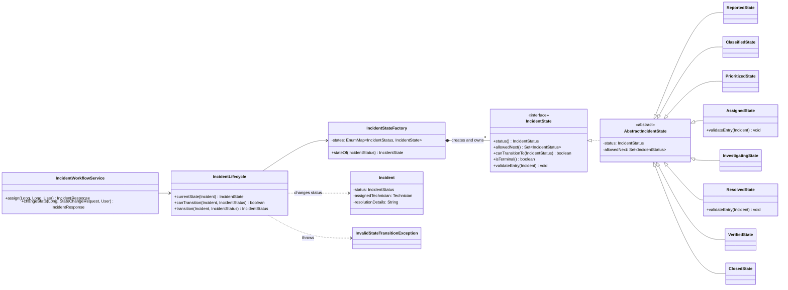
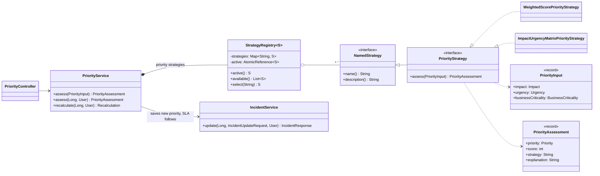
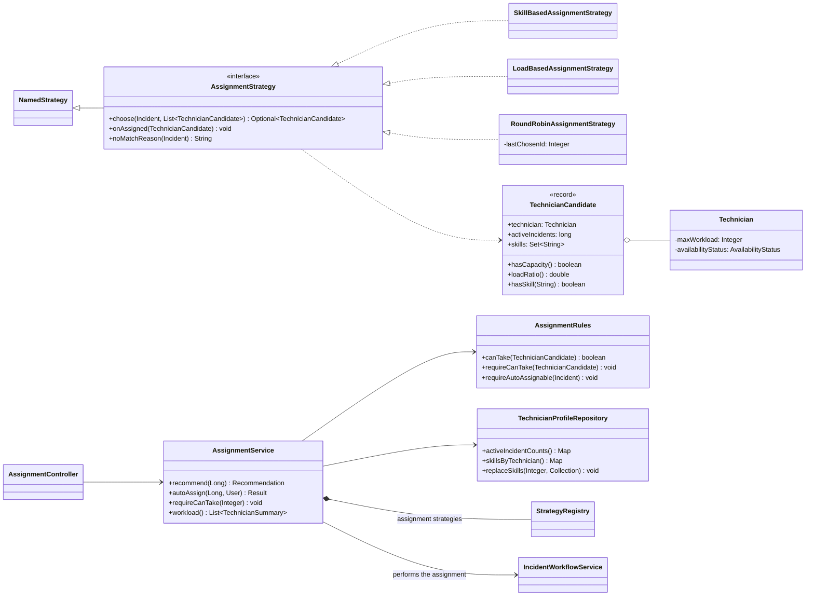
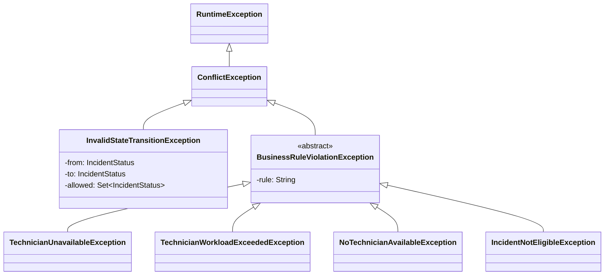

# Class diagram: domain logic (Student 3)

Covers the incident lifecycle, priority calculation, technician assignment and business-rule exceptions.
GitHub renders the Mermaid blocks below as diagrams. Entities from `model/` are shown with only the members used here.

## 1. Incident lifecycle (State + Factory)

## 2. Priority calculation (Strategy)

## 3. Technician assignment (Strategy) and business rules

## 4. Exceptions

All of these return **HTTP 409 Conflict** through the existing `GlobalExceptionHandler`.
