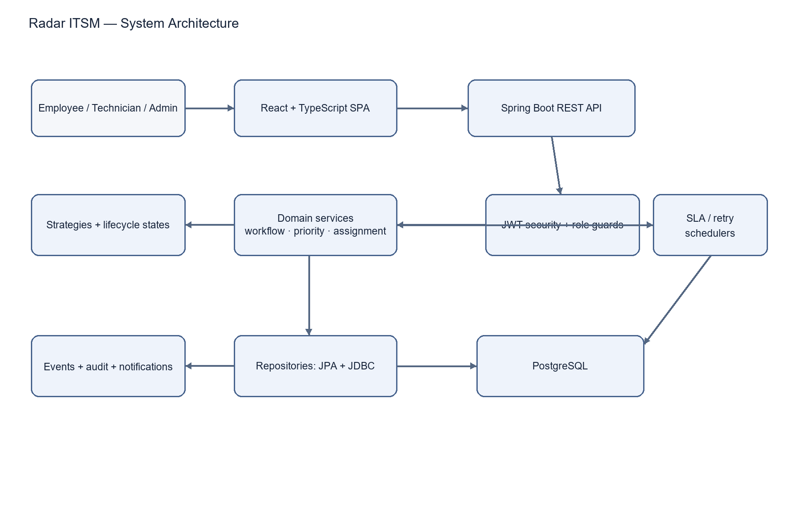

# 3. Architecture

## Overview

Radar is a React/TypeScript SPA calling a Spring Boot REST API. The API validates JWTs, applies role and ownership rules, executes domain services and persists data in PostgreSQL. Scheduled SLA checks and simulated-email retries run in the backend. In-app notifications are persisted; email is simulated.

Editable source: [`architecture.mmd`](diagrams/architecture.mmd).

## Request flow

1. The frontend logs in at `/api/auth/login` and sends a bearer token.
2. Spring Security validates the JWT; controllers/services enforce role and ownership access.
3. A controller validates a DTO and delegates to a service.
4. The service applies lifecycle, priority, assignment, duplicate or SLA logic and persists through repositories.
5. Events drive audit/notification persistence; simulated email listeners run after commit and record attempts.
6. Response DTOs return to the frontend, which refreshes the view.

## Components

| Component | Responsibility |
|---|---|
| React pages/components | Auth, role dashboards, incident forms/lists/details, comments, notifications, admin views |
| API client/endpoints | Base URL, token header, typed requests and route constants |
| Controllers/DTOs | HTTP boundary, validation, authorization, transport mapping |
| Domain services | Workflow, priority, assignment, duplicates, SLA, notifications, users, comments |
| Strategy registry | Selects priority and assignment implementation by stable key |
| Lifecycle state model | Legal transitions and state-specific guards |
| Repositories | JPA persistence plus JDBC technician profile/workload query |
| PostgreSQL | Durable identity, incident, reference, SLA, history and notification data |
| Listeners/schedulers | Audit/notification reactions, SLA scanning, email simulation/retry |

## Cross-cutting and deployment

JWT is stateless; employee incident reads are restricted to their own records. Business operations use service transactions. Scheduled SLA scans are bounded; delivery attempts and retry metadata persist. Seeds are idempotent and applied on PostgreSQL startup. For local setup, configure PostgreSQL/environment values, run the API (8080 default) and Vite frontend separately. Hosting, TLS, secret management, and real email are deployment concerns not supplied here.
