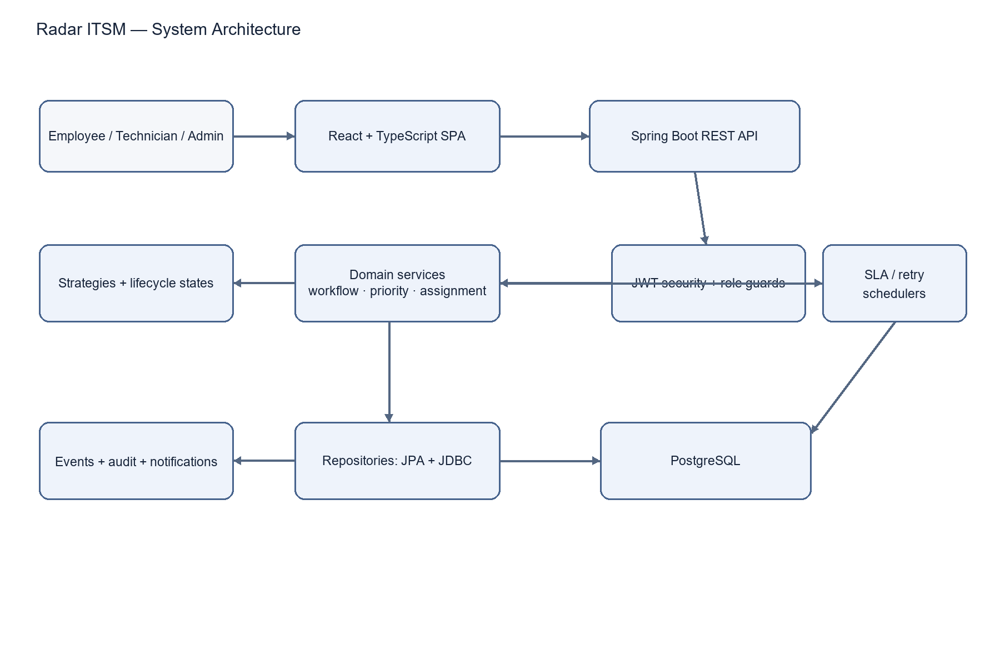
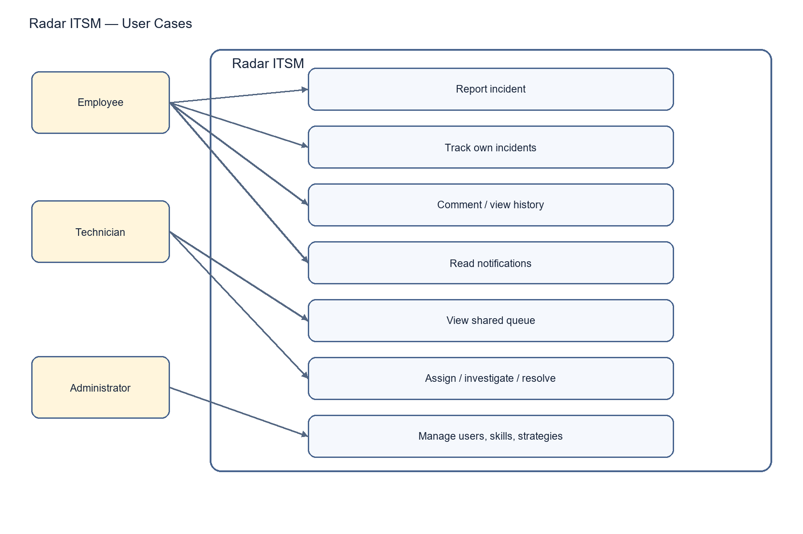
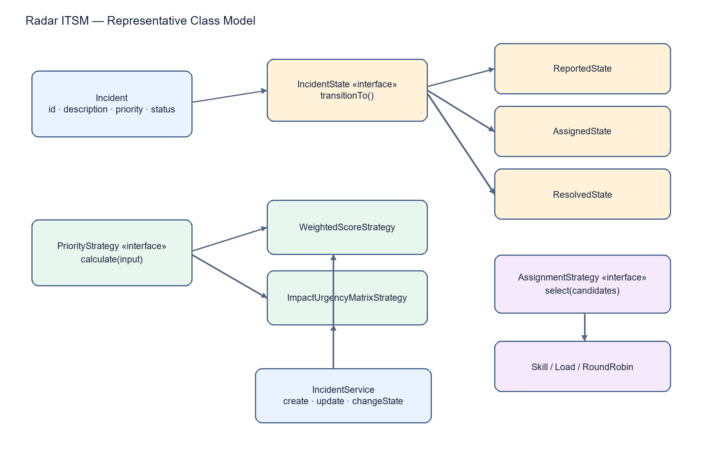
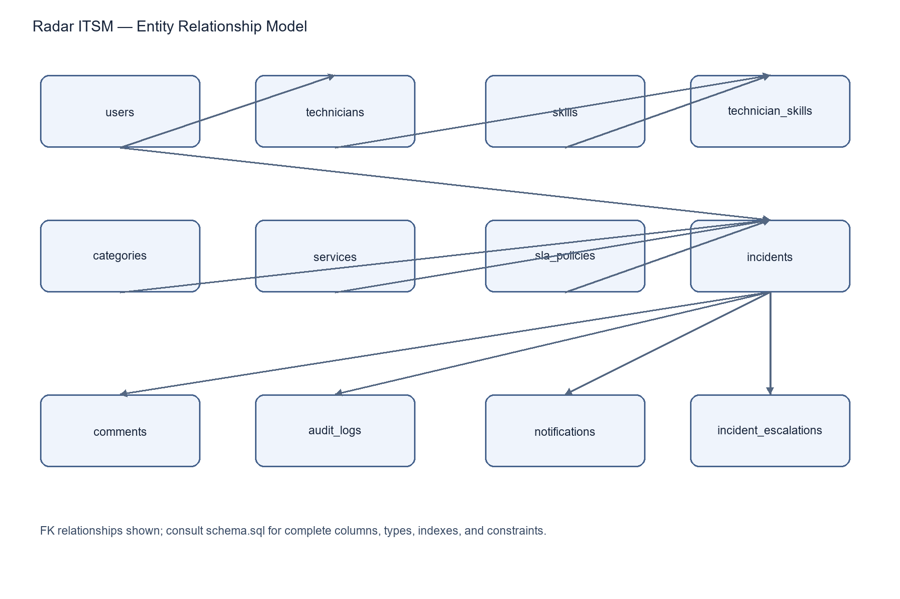

# 4. UML diagrams

Editable Mermaid source and preview images are maintained in `diagrams/` and included in the consolidated PDF.

## Architecture

Source: [architecture.mmd](diagrams/architecture.mmd).

## Use cases

Source: [use_case.mmd](diagrams/use_case.mmd).

## Class model

Source: [class_diagram.mmd](diagrams/class_diagram.mmd). This is a representative domain/service/pattern view, not every DTO or framework repository method.

## Entity relationship model

Source: [er_diagram.mmd](diagrams/er_diagram.mmd). See [database design](07_database_design.md); `database/schema/schema.sql` is authoritative for columns/constraints.
