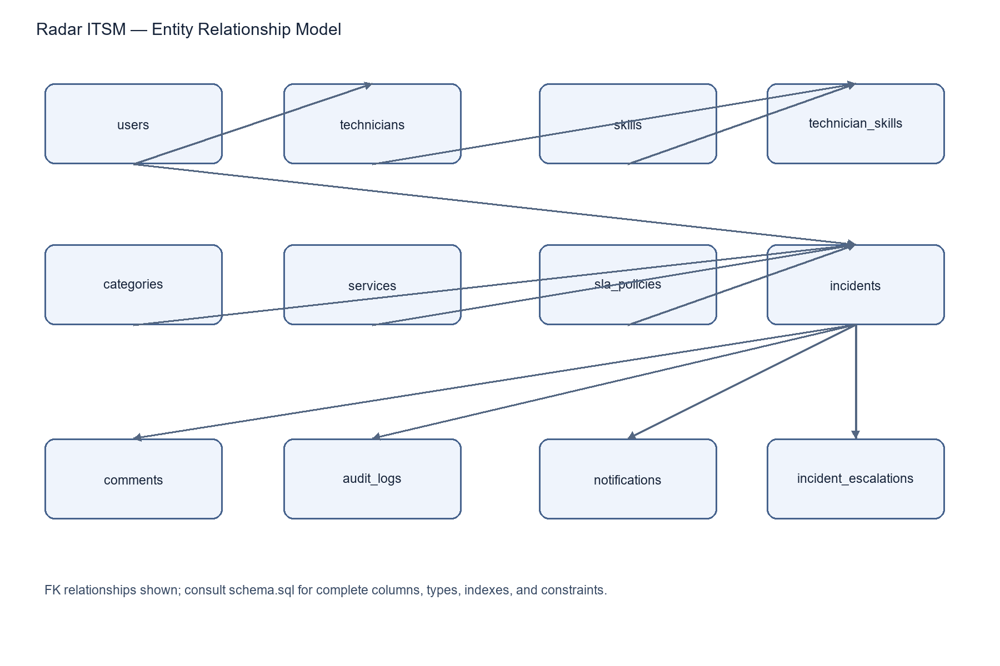

# 7. Database design

## Persistence model

PostgreSQL is the system of record. `database/schema/schema.sql` is the current fresh-install baseline. `database/migrations/` is the upgrade path for existing installations; do not replay those migrations after applying the already-current baseline. `001_reference_data.sql` and `002_skills.sql` are idempotent, and startup reapplies both on PostgreSQL.

Source: [`er_diagram.mmd`](diagrams/er_diagram.mmd). Exact types, constraints and indexes are defined by the SQL baseline.

## Table summary

| Table | Purpose / key links |
|---|---|
| `users` | Identity/role/password hash; reporter, audit actor, notification recipient and commenter |
| `technicians` | One-to-one user profile, availability and workload limit |
| `skills` | Skill names; seeded from category names |
| `technician_skills` | Technician-to-skill join |
| `categories` | Incident classification lookup |
| `services` | Affected-service lookup; no category mapping constraint in current schema |
| `sla_policies` | Priority response/resolution durations; unique policy per priority |
| `incidents` | Ticket, reporter/category/service/assignee, priority/status, deadlines and objective state |
| `comments` | Incident discussion and author |
| `audit_logs` | Incident action/change history, actor and timestamp |
| `notifications` | Recipient event, idempotency key and delivery state |
| `incident_escalations` | Breach escalation linked to incident/objective |

One user can report many incidents; each incident has one reporter and optional technician. A technician has many skills through the join table. Incidents have many comments, audit events, notifications and escalations. Categories/services are independently referenced by incident IDs. SLA response and resolution objectives have independent deadlines/statuses.

## Reference data

Seeded category examples include Hardware, Software, Network, Database, Cloud, Security, Authentication, Application and Storage, along with additional existing values such as Access and Accounts. Services include the ten assignment examples plus prior values. Exact values are in `database/seed/001_reference_data.sql`. No category-to-service mapping exists in the schema; the incident UI offers both lookups independently. Technician skills are persisted in `skills` and `technician_skills`.

## Setup paths

- Fresh database: apply schema, then `001_reference_data.sql`, then `002_skills.sql`.
- Existing database: apply pending migrations in numeric order, then current idempotent seeds.
- Startup initializer applies both seed resources in order.
- `database/verify_reference_data.sql` checks expected values.

See [`../database/README.md`](../database/README.md). Do not use production credentials for integration tests; local secrets are intentionally omitted here.
